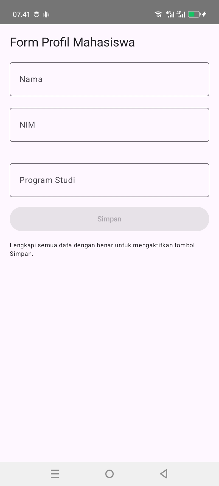
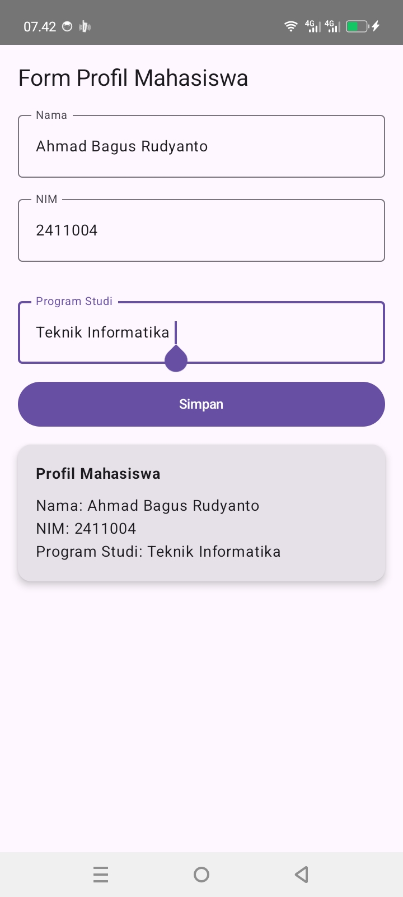
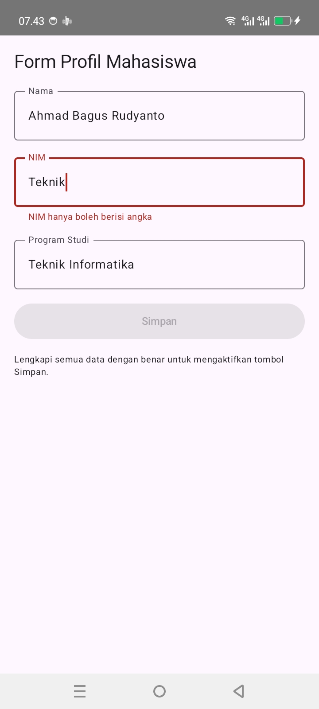

# Form Profil Mahasiswa - Jetpack Compose

Tugas mata kuliah Pemrograman Aplikasi Bergerak, Universitas Mulia.

## Identitas
- Nama: Ahmad Bagus Rudyanto
- NIM: 2411004
- Kelas: IFB5J

## Deskripsi
Aplikasi Android sederhana berupa form profil mahasiswa yang dibuat dengan Jetpack Compose. Input pengguna disimpan sebagai state, dan tampilan diperbarui otomatis lewat recomposition.

## Fitur
- 3 input TextField: Nama, NIM, dan Program Studi.
- Validasi sederhana: NIM hanya boleh berisi angka, dan tombol Simpan aktif hanya saat semua data terisi dengan benar.
- Pesan umpan balik saat NIM tidak valid.
- Kartu profil muncul setelah tombol Simpan ditekan.
- Tombol Reset untuk mengosongkan semua isian.

## Konsep yang diterapkan
- State: remember dan mutableStateOf menyimpan isi form.
- Event: onValueChange dan onClick mengubah state.
- Recomposition: tampilan diperbarui otomatis saat state berubah.

## Cara menjalankan
1. Clone repository ini.
2. Buka di Android Studio dan tunggu Gradle sync selesai.
3. Sambungkan HP Android (USB debugging) atau emulator, lalu klik Run.

## Screenshot

Sebelum input:

Sesudah input dan Simpan:

Validasi NIM:

